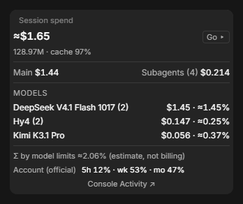

# opencode-usage-pill

Unofficial **OpenCode Desktop** workaround for the hidden session cost on
[OpenCode Go](https://opencode.ai/docs/console/go) sessions.

Since 2.2.0 OpenCode records the provider-reported cost, and Go usage inside
the plan reports `$0`. The built-in Context cost line is therefore hidden for
Go sessions. This plugin adds a separate `ComposerPill` above the prompt with a
clearly labelled **estimate** of the list cost and the share of the published
Go monthly limits.

> This is not official billing. It does not restore the built-in Context cost
> line. It is a Desktop-only stopgap; the upstream optional estimate is tracked
> in [#59861](https://github.com/anomalyco/opencode/issues/59861) and the TUI
> implementation in [#59864](https://github.com/anomalyco/opencode/pull/59864).

## What it shows



- Estimated `list_cost`: `tokens × catalog price`, including Go peak
  multipliers.
- Per-model split: separate rows for models used by the same chat, including
  subagents and mid-session model switches. A trailing `(2)` means the model was
  used in two sessions of the family, for example the main chat and a subagent.
- Official account `5h / week / month` percentages are displayed separately
  from the estimate.
- `Σ by model limits` is the sum of each model's `cost / published monthly
  limit`. It is an estimate, not the official monthly percentage.
- Composer pill, Settings page, plan selector, history loading, and an on/off
  switch.

## Requirements

- OpenCode Desktop **2.3.2** (the GUI plugin API is experimental and may change
  between releases).
- Tested on Windows 11. macOS and Linux are not tested.
- The estimate is designed for `opencode-go` models. Other providers can show a
  dollar estimate, but no percentage without a Go limit.

## Install

The prebuilt GUI bundle is committed, and the server part has no runtime
dependencies. There is no `npm install` step for normal use.

1. Clone this repository somewhere stable, **outside**
   `~/.config/opencode/plugins/`. That folder is auto-loaded, so a clone inside
   it plus a config entry would register the plugin twice.
2. Add a local plugin entry to your global `~/.config/opencode/opencode.jsonc`:

```jsonc
{
  "$schema": "https://opencode.ai/config.json",
  "plugins": [
    {
      "package": "/absolute/path/to/opencode-usage-pill",
      "options": {
        "enabled": true,
        "plan": "go",
        "history": "switch"
      }
    }
  ]
}
```

On Windows use forward slashes, for example:

```jsonc
"package": "D:/plugins/opencode-usage-pill"
```

3. Reload the server: run `opencode reload` in a terminal, or restart the
   OpenCode background service. Then press `Ctrl+R` in the desktop window.

The plugin id is `usage-pill`, so settings survive if you move the directory.

> Do not keep a second copy of the plugin in `~/.config/opencode/plugins/`:
> local plugin folders there are loaded automatically, and two copies with the
> same id fail with `Duplicate plugin ID`.

## Options

| Option    | Values                              | Default    | Meaning |
| --------- | ----------------------------------- | ---------- | ------- |
| `enabled` | `true`, `false`                     | `true`     | Show the pill. |
| `plan`    | `go`, `go-plus`, `go-teams`         | `go`       | Monthly Go limits used for percentages. |
| `history` | `button`, `auto`, `switch`          | `button`   | Load full transcript by button, when the popover opens, or when switching to a chat. |

All options can also be changed in **Settings → Session spend**.

### Settings

- **Show counter** — hides the pill and the refresh command; the Settings page
  stays available.
- **Plan** — Go / Go Plus / Go Teams; affects the monthly limit and the
  percentage.
- **History** — `By button` / `On popover open` / `On chat switch`.

`On chat switch` loads the full transcript of the chat you switch to in the
background. Only the active chat is loaded; other chats are not touched. It is
local history reading, not model requests, so it does not spend Go tokens.

## How the estimate works

For every assistant and compaction message:

```
cost = input × P_in + (output + reasoning) × P_out
     + cache_read × P_cache_read + cache_write × P_cache_write
```

Prices come from the public Go catalog
(`https://opencode.ai/inference/go/v1/models`), with the catalog's peak
multipliers applied by the message's UTC timestamp. The plugin groups messages
by the model that actually produced them; `model-switched` events are used to
attribute history that is not loaded yet.

The official account percentages come from
`/api/experimental/usage/limits`; they are account-wide and are not the same as
the session's estimated share of model limits.

## Development

```bash
npm install
npm run typecheck
npm run build
```

`npm run build` writes the single prebuilt `gui-experimental.cjs` bundle.
Commit the rebuilt bundle when changing `src/`.

The server part is `src/index.js`; it is intentionally empty and has no runtime
dependencies. The GUI part is `src/gui.tsx`; the shared calculation is in
`src/usage.ts` and `src/catalog.ts`.

## Privacy

- Reads local session/message data through the OpenCode Desktop client.
- Fetches the public Go catalog from `opencode.ai`.
- Does not send API keys, prompts, or session contents to the plugin author.
- The Go catalog request is public and unauthenticated.

## License

MIT. Not affiliated with OpenCode or Anomaly Innovations.
